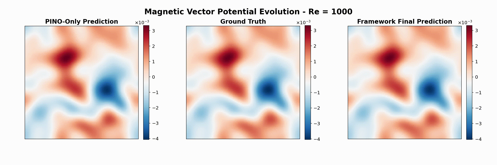

# DINOs: Diffusion-Integrated Neural Operators

[](https://arxiv.org/abs/2507.02106)
[](https://opensource.org/licenses/MIT)
[](https://www.python.org/)
[](https://pytorch.org/)
[](./)
[](./)

This is the official repository for the paper:

**Resolving Turbulent Magnetohydrodynamics: A Hybrid Operator-Diffusion Framework**
<br>
*Semih Kacmaz, E. A. Huerta, Roland Haas*

> **Novel Achievement**: First successful MHD surrogate model for Reynolds numbers above 250, with dependable performance up to Re = 3000 and reasonable results even at extreme Re = 10000.

## Showcase

<div align="center">
  
  <p><em>Full spatio-temporal evolution of the vector potential in 2D MHD turbulence simulation</em></p>
</div>

### Key Results and Achievements

**This model represents the first successful MHD surrogate capable of handling Reynolds numbers above 250**, a significant advance in computational magnetohydrodynamics. Previous surrogate approaches failed at higher Reynolds numbers due to the extreme complexity of turbulent magnetic field dynamics.

Our hybrid framework achieves:

- **Novel High-Re Capability**: Operates successfully beyond Re = 250 where previous methods failed
- **Validated Performance**: Dependable and reliable up to Re = 3000 with maintained physical accuracy
- **Extreme Turbulence Handling**: Produces reasonable results at Re = 10000
- **Complete Spectral Reconstruction**: Full energy spectra recovery across all resolved scales
- **Long-term Stability**: Maintains physical consistency and statistical properties over extended simulations
- **Advanced Magnetic Field Modeling**: Accurately captures high-wavenumber magnetic field evolution at extreme Reynolds numbers

**Performance Validation:**
- Re ≤ 3000: Dependable performance with full spectral accuracy
- Re = 10000: Reasonable results where no previous surrogate has succeeded
- Unique Capability: Only model capable of high-wavenumber magnetic field evolution at extreme turbulence

## Repository Structure

This repository contains the complete implementation of a novel MHD surrogate model for high Reynolds numbers. The codebase is organized as follows:

```
DINOs/
├── configs/                    # Configuration files for different models and Reynolds numbers
│   ├── config_diffusion_*.yaml # Diffusion model configurations (Re: 250-10000)
│   ├── config_fno_*.yaml       # FNO model configurations
│   ├── config_tfno3d_*.yaml    # TFNO3D model configurations
│   └── config_uno3d_*.yaml     # UNO3D model configurations
├── data_generation/            # MHD simulation and data generation modules
│   ├── main.py                 # Main data generation script
│   ├── simulator.py            # High-fidelity MHD simulation engine
│   ├── random_fields.py        # Turbulent initial condition generators
│   └── diffusion/              # Diffusion-specific data generation
├── src/                        # Core source code for hybrid framework
│   ├── diffusion/              # Score-based diffusion model implementations
│   ├── neurops/                # Physics-informed neural operator implementations
│   ├── data/                   # Data loading and preprocessing for high-Re simulations
│   ├── losses/                 # Physics-constrained loss functions
│   ├── training/               # Training utilities for extreme Reynolds numbers
│   ├── physics/                # MHD equation constraints and validation
│   └── visualization/          # Analysis tools for turbulent flow visualization
├── scripts/                    # Analysis and evaluation scripts
│   ├── evaluate_*.py           # Model evaluation across Reynolds numbers
│   ├── generate_*_plots.py     # Publication-quality spectral analysis plots
│   └── calculate_statistics.py # Turbulence statistical analysis
├── tests/                      # Unit tests and validation
├── assets/                     # Media and documentation assets
│   └── sim_A.gif              # MHD turbulence evolution showcase
├── requirements_*.txt          # Python dependencies for different hardware
├── env_*.yml                  # Conda environment files
└── run_training.py            # Main training script for high-Re scenarios
```

## Installation

```bash
# Clone the repository
git clone https://github.com/your-username/DINOs.git
cd DINOs

# Create conda environment (choose based on your hardware)
# For NVIDIA GPUs
conda env create -f env_gh200.yml

# For AMD GPUs
conda env create -f env_amd.yml

# Activate environment
conda activate NODs  # or NODs_AMD for AMD
```

## Quick Start

### 1. Data Generation

Generate MHD simulation data for training:

```bash
python -m data_generation.main -N 100 -o "./data/mhd_ReXXX" --Re XXX --ReM XXX
```

### 2. Training Neural Operators

Train a TFNO3D model:

```bash
python run_training.py --config configs/config_tfno3d_ReXXX.yaml
```

Train a diffusion model:

```bash
python run_training.py --config configs/config_diffusion_ReXXX.yaml
```

## Model Configurations

The repository includes pre-configured models for various Reynolds numbers:

- **FNO Models**: `config_fno_Re*.yaml` - Fourier Neural Operators
- **TFNO3D Models**: `config_tfno3d_Re*.yaml` - Tensorized FNO with 3D structure
- **UNO3D Models**: `config_uno3d_Re*.yaml` - U-Net style Neural Operators
- **Diffusion Models**: `config_diffusion_Re*.yaml` - Score-based diffusion models

## Key Components

### Neural Operators

- **FNO (Fourier Neural Operator)**: Spectral-based operator learning
- **TFNO3D**: Tensorized FNO with enhanced 3D capabilities (serves as base for PINOs)
- **UNO3D**: U-Net inspired operator with skip connections
- **PINO**: Physics-Informed Neural Operator with PDE constraints using physics-informed loss functions

### Diffusion Models

- **Elucidated Diffusion**: Implementation based on Karras et al. with preconditioned network architecture
- **Sampling Methods**: Standard Heun-like sampling with stochastic churn (DPM++ solver also available)
- **Conditional Generation**: Uses low-fidelity neural operator predictions as conditioning input

## Citation

If you find this work useful in your research, please cite our paper:

```bibtex
@misc{kacmaz2025resolving,
      title={Resolving Turbulent Magnetohydrodynamics: A Hybrid Operator-Diffusion Framework}, 
      author={Semih Kacmaz and E. A. Huerta and Roland Haas},
      year={2025},
      eprint={2507.02106},
      archivePrefix={arXiv},
      primaryClass={physics.flu-dyn}
}
```

## License

This project is licensed under the MIT License - see the [LICENSE](LICENSE) file for details.

## Contributing

We welcome contributions! Please feel free to submit a Pull Request. For major changes, please open an issue first to discuss what you would like to change.

## Contact

For questions about the code or paper, please:

- Open an issue on GitHub
- Contact the authors via email
- Join our discussions in the Issues section

---

**Note**: This repository contains the complete codebase used in our research. For reproducibility, we provide detailed configuration files, training scripts, and evaluation tools. Please refer to the paper for theoretical details and experimental methodology.

